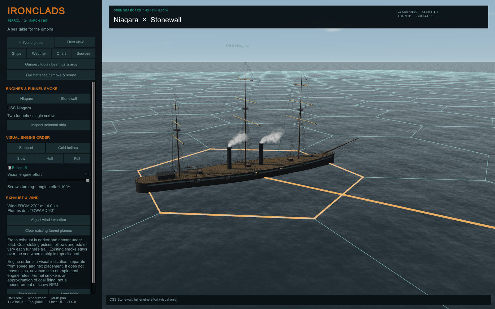

# Ironclads — Ferrol

**Version 1.0.0** — a Windows virtual sea table for a human umpire. Download the Windows ZIP from [GitHub Releases](https://github.com/murdockpeter/ironclads_digitized/releases), extract the entire archive, then run `Ironclads.exe`. Keep its `_Data` folder and Unity DLLs beside it. No Unity installation or network connection is needed to play.

The public release includes the procedural ships, sea/globe, weather/sun, board tools, firing effects and engine exhaust. User-supplied rulebook/ship-sheet scans and research photographs are excluded. The reference panel handles their absence. This is an independent companion tool; no affiliation with or endorsement by the original board-game publisher is implied.

To build from source, use Unity **6000.2.12f1** and invoke `Ironclads.Editor.ProjectBuilder.DeliverRelease` (batch command in [build instructions](Documentation/BUILD.md)). The player is written to `Builds/Windows-v1.0.0`. Generated prefabs/meshes, development artifacts, private references and editor caches are intentionally excluded from Git; preparation regenerates the assets.

A Unity 6 desktop sea table for an umpire-run **USS Niagara vs CSS Stonewall** encounter. The globe, ocean and ships are rendered in 3D; the umpire controls the board and adjudicates the game.

**Current models: pass 4.** Niagara has a rounded stern, fuller quarters, curved gallery fittings and a matching taffrail. Both ships have approximately twice the vertices and twice the render meshes of the integrated forecastle revision, with finer hull/cannon surfaces and additional boat, armor and deck fittings. Use **Bow detail**, **Gun detail** and **Stern detail** to inspect them. See [pass-4 notes](Documentation/MODEL-PASS-4.md) and `Artifacts/Pass4/model-counts.txt` for measured changes and historical limits.

**Stonewall bow follow-up:** `Builds/Windows-BowRevision/Ironclads.exe` contains the integrated armored forecastle correction. It was built alongside the existing player to preserve the user's open session. The separate circular forward drum and roof have been replaced by a raised hull enclosure with an opening in the raked bow. See [revision notes](Documentation/STONEWALL-FORECASTLE-REVISION.md). Niagara's exact hull outline remains [unverified against a lines plan](Documentation/NIAGARA-HULL-REVIEW.md).

## Run

After building from source, open `Builds/Windows-v1.0.0/Ironclads.exe` or run `Start-Ironclads.ps1` from PowerShell. Previous local development players remain in their own directories. Keep the executable beside its `_Data` folder and Unity DLLs.

For development, add this directory to Unity Hub with **Unity 6000.2.12f1**, open `Assets/Scenes/Ferrol.unity`, and press Play. The scene controller creates the world at startup. There are no paid assets, API keys, accounts, or runtime network dependencies.

## At the table

- **Ships:** select a vessel, inspect it, place it by local hex ID, or hold Shift and click the sea. Ahead/astern move one hex; facing buttons change heading by 60°. No movement allowance or turning capacity is enforced.
- **End turn:** advances the scenario sun/clock by three minutes and increments the turn. It leaves ship positions as placed. Movement and combat phases remain under the umpire's control.
- **Chart:** toggle the 100-yard grid, four-digit local IDs, range line, overhead view, or Stonewall's supplied arc guides. Hex range is distinct from the straight-line distance.
- **Gunnery tools / bearings & arcs:** select Stonewall's sheet arcs or an adjustable custom sector, then measure to the other ship or Alt-click a target hex. Includes bearing, target aspect angle, distance bands and split-hex boundary warnings. Niagara's separate broadside pattern card is not reproduced; see [tool limitations](Documentation/GUNNERY-TOOLS.md).
- **Fire batteries / smoke & sound:** trigger Niagara's five-gun port/starboard Parrott salvos, Stonewall's forward 300-pounder or individual 70-pounders, or an all-guns display. Reports, flashes and powder smoke originate at the modeled muzzles. Adjust cannon volume, ripple timing and smoke density; weather wind transports existing clouds. [Effect details](Documentation/BATTERY-EFFECTS.md).
- **Ships → Engines & funnel smoke:** set each vessel's visual engine effort and boilers independently. Niagara's two funnels and Stonewall's single funnel emit dark coal-smoke trails with wind drift and billowing. Cold boilers stop new smoke; stopped screws with banked boilers retain light wisps. Settings save with the table and do not move ships. [Engine exhaust notes](Documentation/ENGINE-EXHAUST.md).
- **Weather:** adjust wind direction/speed, cloud, rain, wave scale and visual visibility. Set a UTC date/time and geographic location for the sun.
- **Sources:** view optional user-supplied ship sheets/PDFs when present. These scans are excluded from the public release. The 1865 scene keeps the ten-Parrott working outfit.
- **Model pass 2:** use **Bow detail** and **Gun detail** under Ships for closer inspection. Closed hull ends, joined deck seams, open gun ports and shaped cannon barrels replace the first-pass geometry. Earlier source/OBJ/image snapshots are retained in `Artifacts/Pass1`; second-pass review images and checks are in `Artifacts/Pass2`.
- **Save/Load:** stores positions, weather, time, turn and notes in `ferrol-scenario.json` under Unity's persistent data directory. **Log positions** appends a CSV snapshot; **Undo placement** restores a previous board state in the current session.
- Turn off hex placement for optional continuous heading and simple knot-based movement. This is a separate visual convenience; movement points are not converted into knots.

| Control | Action |
| --- | --- |
| Right mouse drag | Orbit camera or rotate globe |
| Wheel | Zoom |
| Middle mouse drag / WASD | Pan sea camera |
| 1 / 2 / F | Inspect Niagara / Stonewall / selected vessel |
| Tab | Globe / sea |
| Shift + left click | Place selected vessel in a local hex |
| H | Hide/show controls and labels |
| F12 | Save screenshot |
| Escape | Exit standalone player |

The globe is a separate scale from the meter-based tactical scene. Click it to relocate the sea board; local ship spacing is preserved. Local terrain and bathymetry are not generated from the satellite image. The globe is rendered with a geographic texture and day/night illumination; there is no seamless flight from orbit into coastal terrain.

## Rules compatibility

The supplied `contextonly/NEW_IRONCLADS_RULES.pdf` establishes approximately 100 yards per hex and three minutes per turn (p. 3), hexside facings (pp. 9–10), and shortest-path hex range (p. 18). The chart uses **91.44 meters between adjacent centers**, six facings and integer hex distance. Models retain their physical dimensions rather than being scaled as cardboard counters. Niagara's bowsprit extends beyond her occupied hex; the highlighted center hex determines her game location.

This is a **new 41 × 37 open-sea board** with custom local IDs, not a scan of mapboards I–IV. The original mapboard artwork is absent from the supplied folder. Their numbering, coastlines, active shoals, current zones and scenario entry/exit boundaries are not reproduced. The included Ferrol setup is a two-vessel what-if; the book's Scenario 4D also uses Sacramento. See [rules mapping](Documentation/RULES-COMPATIBILITY.md).

## Generated assets and verification

`Assets/Generated` contains reusable mesh assets, materials and ship prefabs. `Shipwright.Create(stonewall, combine: false)` regenerates individually named parts for editing; the default combines meshes by material for rendering. OBJ geometry exports and Unity-rendered previews are in `Artifacts`. OBJ exports contain geometry only; Unity prefabs include materials.

Use the **Ironclads** editor menu to prepare assets, verify the board/navigation, render previews, or build Windows. Batch commands are in [build instructions](Documentation/BUILD.md). Preparation runs behavioral checks for board scale, range, facings, globe coordinates, solar orientation and movement units. Runtime player logs provide separate rendering/startup checks.

## Visual scope

This release includes generated, historically informed ship reconstructions, animated waves and ship roll, directional sun and sky, procedural clouds, rain, funnel smoke, generated ocean ambience, and manual umpire tools. It is not a finished photorealistic ship simulator. Hull lines, rigging, deck furniture and gun mounts need plan-based refinement. Clouds, waves, fog and ship motion are artistic approximations. Cannon salvos are visual/audio effects; combat, damage, sinking, grounding, collisions and rules enforcement are not automated.

Historical dimensions and photographs, NASA imagery attribution, solar method and known disagreements are documented in [historical notes](Documentation/HISTORICAL-NOTES.md). The supplied rules and ship sheets remain user-provided reference material; their inclusion is not a license to distribute them.
